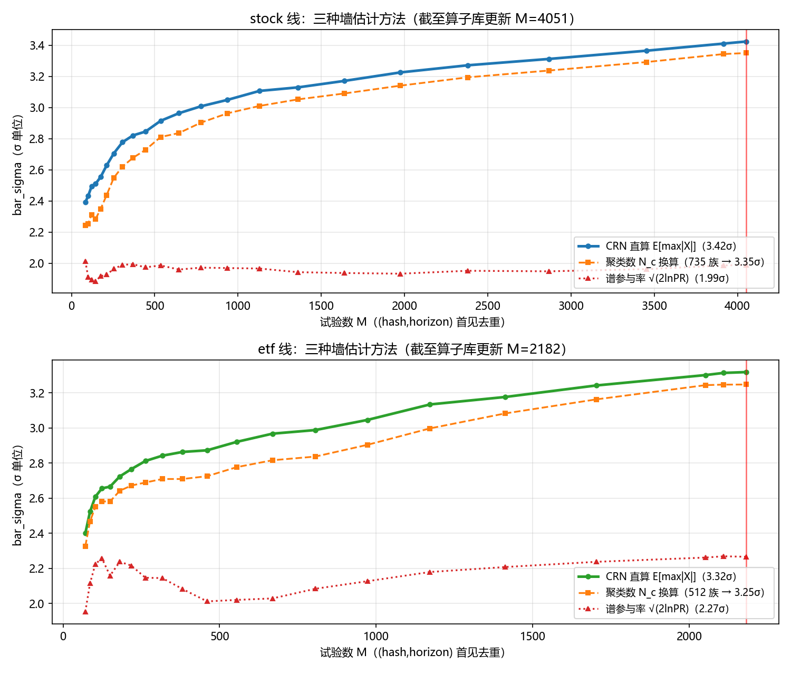

# 三种墙估计方法：CRN 直算 · 聚类数换算 · 谱参与率

- 日期：2026-10-07
- 数据口径：真实历史重放（生产 `trail_engine.json`，现行 v4 算法在历史前缀上统一重放；试验单元 $(hash,horizon)$ 首见去重）。**截至 09-19 算子库更新**：stock $M\le4051$、etf $M\le2182$。
- 母本：[`REPORT-multiple-testing-survey-and-wall-growth-2026-10-07.md`](REPORT-multiple-testing-survey-and-wall-growth-2026-10-07.md)（§二 全机制推导、§三 全量历史增长与后果分析）。本文回答两个问题：**图上被定价的试验从哪来（算子库与随机因子生成）**、**三条曲线各自是什么方法、公式长什么样、为什么给出不同的墙。**

---

## 〇、试验从哪来：算子库与随机因子生成

图上被定价的试验大头不是人写的——trail 条目口径下，**stock 线 82%（3425/4177）、etf 线 32%（1168/3660）出身 `origin=random`**（另有部分早期条目无署名）。它们由**随机表达式树生成器**产生；同一条产线供两端，这是理解墙的关键设计。

### 生成器三件套与双模式

| 件 | 职责 |
|---|---|
| `factor/random_gen.py` | 组合树采样 + factor 源码渲染 + 结构约束校验 |
| `factor/ops.py` | **算子真值源**（生成器只做组合，不重写数学） |
| `analysis/glm_mining/farm.py` | 外层循环（批量供数） |

- **explore 模式（挖矿）**：生成 $n$ 个随机因子 → 轻量 IC 扫描 → 返回 top-$k$ 的源码给 agent 走标准管线（causality → evaluate → evaluate_batch deflate）。**随机幸存是选择不是结论**——真正的定价发生在标准管线里。
- **null-calibration 模式（墙校准）**：生成 $n$ 个 → 全部轻量 IC → 经验 null 分布（$\mathrm{IC}_{\mathrm{IR}}$ 分位数）落盘 `null_landscape.json`。**这就是 pool_std 的来源**——§方法一里 $sr_0=\bar\sigma\times\sigma_{\mathrm{pool}}$ 的纵向刻度 $(p_{90}-p_{10})/2.5631$ 测的就是这个随机空间的地形。
- 防伪：explore 与 null-calibration **拒绝同 seed**（防前缀重放制造假发现）；算子集指纹 `opset_fingerprint`（算子名单+参数集+**实现源码哈希**+模板占比）写进 null 地形指纹——扩算子/改实现后旧地形判 mismatch 强制重校准（修掉"扩算子墙口径静默漂移"的缝，2026-09-19 随扩充落地）。

### 随机表达式树：采样空间与结构约束

每个因子是一棵表达式树，叶子从 6 个行情字段采样：

$$
\text{leaf}\in\{\,o,\ h,\ l,\ c,\ v,\ \text{amount}\,\},\qquad
\text{树} = \mathrm{op}(\cdots\mathrm{op}(\text{leaf},\,w)\cdots)
$$

**算子库**（`OPERATOR_REGISTRY`，现行 **61** 个，全部向量化 (T,N)、因果安全只向后看）：

| 类别 | 数量 | 例 |
|---|---|---|
| 时序 ts_*（窗口沿时间轴） | 34（含双输入 8、三输入 1） | mean/std/rank/zscore/slope/momentum/delay/diff、corr/cov/vol_ratio、resid/beta（滚动回归残差/对冲系数）、wmean（加权均值）、drawdown/range_pos/arg_max/median/iqr/winsor/streak、coskew/triple_corr（共矩） |
| 截面 cs_*（每日截面） | 6 | rank / zscore / winsorize / scale / demean / robust_z |
| 二元（逐元素） | 8 | add/sub/mul/**保号 div**/minv/maxv/signed_diff/sfdiff（无量纲差） |
| 单目变换 | 10 | abs/sign/log_signed/softsign/sigmoid/tanh/inv… |
| 比较+条件 | 2+1 | gt/lt + where（条件三分支：cond·a+(1−cond)·b） |

参数采样集：窗口 $w\in\{3,5,10,20,60,120,250\}$、延迟 $d\in\{1,2,3,5,10,20\}$、换手阈值 $h\in\{0.01,0.05,0.10\}$。用户可经 `operator_set.json` 覆盖（disable/改窗口集/模板占比），生效集即采样空间。

**结构约束（防浅层的生死线）**：深度 3..5；**至少 1 个时序 + 至少 1 个截面算子**（"提取不可直接观测的潜在结构"的可执行判据——纯截面 or 纯时序树直接拒绝）；二元两子树不全叶（禁 c1/c2 纯数据运算）；同空间二元（add/sub/minv/maxv/signed_diff）两子树必须同空间（单位匹配，2026-09-18 R2 规则）。

**结构模板通道**（默认占比 0.3）：`leg_weight`（量腿加权）/ `hedge_resid`（对冲残差）/ `window_spread`（窗口差）/ `cond_gate`（门+腿）——收官战役手工构造的结构骨架机械化为带槽采样模板，"出身=结构先验"。

**扩张史（= 主报告图 2 的 09-19 标记线）**：起步 **36** 算子 → 09-18 结构扩充（回归残差族 ts_resid/ts_beta、指数衰减、换手 hump、条件三分支 gt/lt/where）→ 09-19 两批（加权/回撤区间/稳健统计/持续性/共矩/变换族）→ 现行 **61**。主报告 §3.4 的实证结论：这次扩表**没有**降低试验同源度（平均实测 |ρ| 反微升）——多样性瓶颈在 6 个叶子字段与共同市场模式，不在算子词表。

**诚实边界**（模块自述）：curated 算子集是人类先验，决定了能发现什么——这是"结构化空间的随机探索"，**不是无偏搜索**。正因如此，墙才必须按全部试验计价（不管出身），而机制层分层计价（按 origin 署名分账）再把这个先验先验地折回去——两层各司其职。

---

## 方法一：CRN 直算 $E[\max|X|]$（现行引擎的门参数）

**定义。** 在"全部 $M$ 个试验都纯靠运气"的零假设世界里，最幸运者期望爬到的高度：

$$
\bar\sigma \;=\; E\Big[\max_{i\le M}\ \big|X_i\big|\Big],\qquad X\sim N(0,R),
$$

其中 $R$ 是全部试验两两**实测**的 IC 相关矩阵（sketch 尾对齐、公共尾长一次 Gram、签名相关；重叠 $<60$ 点的对按独立计——独立是 $E[\max|X|]$ 的最贵假设）。

**为什么必须对整个 $R$ 蒙特卡洛。** $E[\max|X|]$ 依赖 $R$ 的完整谱排布（哪些方向强、强多少、互相怎么嵌套），不是任何标量摘要的函数——本文方法三就是反例。

**采样实现（公共随机数，条件高斯增列）。** 固定种子生成独立标准正态列 $Z_j\in\mathbb R^K$（$K=20000$），PSD 投影后 $X=ZA^{\top}$。新增第 $M+1$ 个试验（与既有试验的相关向量 $r$）时，由分块协方差的条件高斯公式：

$$
x_{M+1} = X\,v + \sqrt{s}\;z_{M+1},\qquad v = R^{-1}r,\qquad s = 1 - r^{\top}R^{-1}r,
$$

旧列**一个数都不动**、只多一个 $|x|$ 候选，因此

$$
\text{（单调性定理）}\qquad B\supseteq A \;\Longrightarrow\; \max_{i\in B}|X_i|\ \ge\ \max_{i\in A}|X_i|\ \text{逐路径成立}
\;\Longrightarrow\;
\bar\sigma\ \text{对 } M \text{ 单调不减}。
$$

**性质。** $M=0\Rightarrow\bar\sigma=0$；$M=1\Rightarrow\bar\sigma=E|Z|=\sqrt{2/\pi}\approx0.798$（连符号都是选出来的——冷启动即有选运底价）。最终门：$sr_0=\bar\sigma\times\sigma_{\mathrm{pool}}$，$p=\bar\Phi(t_{\mathrm{adj}})$（见母本 §2.5–2.6）。

---

## 方法二：聚类数换算（尾部线同构的计数式形态）

**先澄清历史（避免误读图 1 橙线）**：因子线的墙**从未**被聚类数定过价——三代演化是线性 $N_{\mathrm{eff}}$（08-16）→ 谱参与率（08-18~21）→ CRN（08-21 至今）。用聚类数计价的现役闸门是**尾部线**：`tailgate.tail_n_eff` 对名单 MinHash-Jaccard $\ge0.25$ 的对做**并查集连通分量**，族数即 $N_{\mathrm{eff}}$，bar $=E[\max X](N_{\mathrm{eff}})\cdot s_0+z\cdot s_0$（单侧）。本图橙线是在**因子线试验**上用 sketch 相关 $|\rho|\ge0.6$ 的同构并查集演示这一族估计量（相似度空间不同，传递闭包结构相同）。

**定义（本文重放口径）。** sketch 相关 $|\rho_{ij}|\ge0.6$ 的对连边（只连实测对，缺测=自成一族），连通分量数即族数 $N_c$；然后**假装全池只有 $N_c$ 个互相独立的试验**：

$$
N_c = \#\{\text{连通分量}\},\qquad
\widehat{\mathrm{bar}}_{N_c} = E\Big[\max_{i\le N_c}|Z_i|\Big],\qquad Z_i\ \overset{iid}{\sim}\ N(0,1),
$$

其中独立极值的经典渐近（Gumbel 极限，$\gamma\approx0.5772$）：

$$
E[\max_{i\le N}|Z_i|] \;=\; u_N + \frac{\gamma}{u_N} + o\!\big((\ln N)^{-1/2}\big),\qquad
u_N = \sqrt{2\ln N} - \frac{\ln\ln N + \ln 4\pi}{2\sqrt{2\ln N}}.
$$

（本图用与 CRN 同估计量的直接模拟取值，避免渐近式在中小 $N$ 的偏差。）

**"族=连通分量"的定义缺陷（实测证实）。** 相关性**不可传递**，连通分量却强加传递性：$|\rho_{AB}|=|\rho_{BC}|=0.6$ 的两条边下，PSD 约束允许链端 $|\rho_{AC}|$ 低至 $-0.28$——隔一跳即可近零。真实数据上的量级：**最大连通分量吞掉全池 81~82%**（stock 3390/4162、etf 2951/3597——0.6 阈值图处于渗流超临界态），**族内对一半以上 $|\rho|<0.3$（近零相关）**（stock 50.9%、etf 62.1%），且把定义换成引擎自己的贪心代表制（`evidence.cluster_families`，种子一跳收编、无传递闭包）族数立刻 +37~45%（730→1055、619→846）——$N_c$ 连"数出来是多少"都由定义选择摆布。代码库里"族"实际三定义并存：尾部线并查集@名单 Jaccard 0.25、证据特质贪心代表制@sketch ρ 0.6、本文重放并查集@sketch ρ 0.6。

**隐含假设与代价。** 这个换算等于宣称：**族内完全冗余**（每族只算一次选择机会）且**族间完全独立**。两者都不是事实：族间实测仍有 $0.2\sim0.3$ 相关（压低真实 $E[\max]$），族内如上远非同臂。更致命的是 $N_c$ 不随 $M$ 单调：新试验把两个既有族连成一家，$N_c$ 下降、墙**随挖掘主动下降**——stock 线实测到两次（29→27 族、735→730 族），等于给"刷同族变体洗墙"开后门。

**尾部线为什么没用 IC 线同款（CRN）——三条原因。** ①**原料没留住**：尾部块只落标量（spread_ir/spread_moments/tail_ic 等）+ 名单 MinHash 签名（128B），spread 序列本身不落盘——CRN 无原料；②**序列太短**：spread 序列受 n_days 支配（gate 门槛 10），几十点的两两相关全是噪声（IC 线自己的 `_MIN_ALIGN=60` 纪律会判掉大多数对，R 大半被迫按独立填 0）；③**语义选择**（设计注释原文）：尾部统计量依赖选中名单，IC 值两两 ρ=0.75 的因子名单可只重叠 0.4——"尾部恰是分歧最大处"，故家族几何换名单 Jaccard。语义上判"同族"是对的，但把族数直接当 $N_{\mathrm{eff}}$ 喂 $E[\max]$，依赖结构被压成连通分量计数——三重病由此进来。

**升级路径（已作废，被 v2 设计取代）**：~~尾块加 `spread_sketch` → CRN 直算~~——该方案把 IC 线方法硬搬过来，丢掉了尾部线的特殊性。**取代方案见 [`DESIGN-tail-wall-v2-2026-10-07.md`](../../analysis/glm_mining/DESIGN-tail-wall-v2-2026-10-07.md)：名单重叠即相关**——null 下两试验 spread 的相关系数有闭式 $\rho_{ij}=(\Omega_{ij}-c)/(1-c)$（$\Omega$=时间平均名单重叠、$c=K/N$ 随机基线；MinHash 签名的 J 与 $\Omega$ 单调换算 $\Omega=2J/(1+J)$），现行 `selection_mh` 从 08-25 起全量在账，零新增持久化即可构造 R 矩阵走单侧 CRN——名单信息一路带到 R，不再压缩成族计数。

### 出身审计（2026-10-07，git 取证 + 生产台账实测）

**这是最初的技术选择吗？——一半是，一半是未记账的简化。** 出生提交 `2a074431`（08-25，Phase 5"尾部线独立多重检验"）明确记录了三个**有意**决策：①家族几何用名单 MinHash-Jaccard（证据在手：IC 值两两 ρ=0.75 的因子名单可只重叠 0.4——"IC 家族链在尾部失效"）；②bar 用 B-LP 计数式 $E[\max](N_{\mathrm{eff}})\cdot s_0$（提交里唯一自认的简化是"高阶矩省略，Phase 6 校准"——次日 WS4 就补上了）；③跨轨 Šidák。但**"计数式 N_eff"本身从未被当作简化记录在案**——没有一条提交、评审或文档讨论过"为什么不用 IC 线的 CRN"。

**三个不利事实（git 证据链）：**

1. **名实不符从胎里**：提交正文与 docstring 都写"贪心聚类"，出生代码就是**并查集传递闭包**——设计意图（贪心）与实现（连通分量）第一天就分叉，此后无人修正（docstring 至今仍写"贪心"）。出生测试是"同族聚簇、异族独立"的玩具用例，链式传递根本不在测试视野里。
2. **职责跨越**：MinHash 机器是同日早晨 `497280c3`（v5 family lineage）为 IC 线**行为停走**（同族链熔断，CMF 事故驱动）而建的；当晚尾部线把它**复用到了统计定门**（deflation）——同一个指纹从"决定何时停"升级到"决定墙多高"，没有补对应的统计论证。
3. **教训未跨轨**：IC 线 08-21 已用 4 天 CRN，且"有效维数标量不是 $E[\max]$ 的充分统计量、谱换算低估 3.4×"的教训（`d2f6934`）已立——尾部线 08-25 仍然采用了同族错误形态（计数 → $E[\max]$），只是 N_eff 换了来源（Jaccard 聚类替代谱参与率）。此后的历次审查（WS1 s0 经验校准、WS4 高阶矩、09-08 演进史报告、09-13 计价审计）全部聚焦 IC 线或 G3 的其它项，**四次都没碰 N_eff 的计数本质**。

**生产台账实测（当前状态，两根线）：**

| | stock | etf |
|---|---|---|
| 尾部试验 n | 4148 | 2797 |
| $N_{\mathrm{eff}}$（并查集@Jaccard≥0.25） | 476 | **18** |
| 最大连通分量 | 3641（88%） | **2779（99%）** |
| 分量内采样 Jaccard 中位 | 0.062 | 0.094 |
| 分量内低于边阈值 0.25 的对 | 93% | 86% |
| 贪心代表制对照 | 1015（+113%） | 242（+1244%） |
| 全门 bar（现行 / 贪心 / 全计数，s0 取 landscape spread 段） | 0.658 / 0.687 / 0.737 | **0.525 / 0.659 / 0.756** |
| **E[max] 项低估（对贪心 / 对全计数）** | +0.029 / +0.079 | **+0.134 / +0.232** |

材料性：etf 在册 106 只中 **72 只走尾轨**（68%），门差 0.13~0.23 个 spread_ir 单位对照 z·s0 项的 ~0.27——**deflation 项被链式塌缩掉了约一半**；且 etf 线 60+ 周期零带内入册的历史现象，与"墙定低了反而更难解释"方向一致（值得后续复核的是 N_eff=18 连墙都近乎失效时 G1/G2 在拦什么）。

**连带待核（本轮发现、未定论）**：registry 的 `diagnosis.tail.spread_ir` 快照与准入规则存在大面积不一致（etf 尾轨 72 只中仅 27 只高于**现行**门水平、最低 −0.47）——疑似后续重评覆盖了 diagnosis 快照（准入权威值在 ledger.json），也可能是 WS4 矩修正路径（判定走 $t_{\mathrm{adj}}$，required 仅为展示）所致；需按 ledger.json 逐条核后方可定论，本轮不改不判。

**修正本文档先前表述**：前版说"s0 有经验 null 校准兜底，墙不完全依赖 N_eff 精度"——审计显示不成立：s0 只校准**尺度**，多重检验计数维度完全由 N_eff 承担，而它正是塌缩项。

---

## 方法三：谱参与率（v2 因子线 2026-08-21 前真用过的形态）

**定义。** 对 $R$ 做特征分解 $R=V\Lambda V^{\top}$，特征值 $\lambda_1,\dots,\lambda_M$ 是试验池在各"独立方向"上携带的方差份额。谱参与率是谱的赫芬达尔集中度的倒数：

$$
PR=\frac{\Big(\sum_{i=1}^{M}\lambda_i\Big)^{2}}{\sum_{i=1}^{M}\lambda_i^{2}},\qquad
\widehat{\mathrm{bar}}_{PR}=\sqrt{2\ln PR}.
$$

**一行代数看穿它。** 相关矩阵对角恒为 1，故 $\mathrm{trace}(R)=M$，而 $\mathrm{trace}(R^2)=\sum_{i,j}\rho_{ij}^2=M+2\sum_{i<j}\rho_{ij}^2$，代入：

$$
PR=\frac{M^2}{M+2\sum_{i<j}\rho_{ij}^2}
=\frac{M}{1+(M-1)\,\bar\rho_2},
\qquad \bar\rho_2\equiv\text{全部对的平均平方相关（缺测按 }0\text{）}.
$$

即 **PR 归根结底只是"平均平方相关的倒数"**（stock 截点 $PR=7.24\iff\bar\rho_2\approx13.5\%$）——$M\times M$ 的整个矩阵被压缩成一个平均数。

**两重死法。**

1. **冻结。** 交换相关 $\rho_{ij}\equiv\rho$ 下谱 = 单点 $1+(M-1)\rho$ 加 $(M-1)$ 重 $1-\rho$，故

$$
PR=\frac{M^2}{[1+(M-1)\rho]^2+(M-1)(1-\rho)^2}\ \xrightarrow{M\to\infty}\ \frac{1}{\rho^2}\ \text{（与 } M \text{ 无关）}，
$$

   于是 $\widehat{\mathrm{bar}}_{PR}\to\sqrt{2\ln(1/\rho^2)}=$ 常数——图上红点线从第 $\sim$200 个试验起全程平坦：此后几千个试验，校正一分未涨。
2. **非单调。** 由精确恒等式，$PR$ 下降 $\iff\bar\rho_2$ 上升——灌一批贴近既有族的变体（平方相关高于现有平均），分母涨得比分子快，**墙随挖掘主动下降**（etf 红点线 $m\approx200\to500$ 的下沉即实测：早期高相关家族 + 测量覆盖扩张把缺测对"从 0 变实测"）。

---

## 终值对照（截至算子库更新）

| 方法 | stock $M=4051$ | etf $M=2182$ | 与 CRN 的差 |
|---|---|---|---|
| **CRN 直算 $E[\max\lvert X\rvert]$** | **3.42σ** | **3.32σ** | — |
| 聚类数换算（735 / 512 族） | 3.35σ | 3.25σ | −0.07σ / −0.07σ |
| 谱参与率 $\sqrt{2\ln PR}$（PR=7.2 / 13.0） | 1.99σ | 2.27σ | **−1.43σ / −1.05σ** |
| （参考）独立上界 $E[\max\lvert Z\rvert](M)$ | 3.80σ | 3.64σ | CRN = 上界 × 0.90 |

**为什么只有 CRN 是对的（充分统计量论证）。** 交换相关下真实选择运气有精确分解 $X_i=\sqrt{\rho}\,F+\sqrt{1-\rho}\,\varepsilon_i$（$F,\varepsilon_i\overset{iid}{\sim}N(0,1)$），由此

$$
E[\max_i|X_i|]=\sqrt{1-\rho}\;E[\max_i|\varepsilon_i|]\ \xrightarrow{M\to\infty}\ \sqrt{1-\rho}\cdot\sqrt{2\ln(2M)}\ \text{（无界增长）}，
$$

而 $\widehat{\mathrm{bar}}_{PR}\to$ 常数、$\widehat{\mathrm{bar}}_{N_c}$ 的行为取决于族数的亚线性增长——**两者随维数的行为与真值根本矛盾**。这就是"有效维数标量不是 $E[\max|X|]$ 的充分统计量"的精确含义：真值需要 $R$ 的完整谱排布，PR 只保留了二阶矩平均（$\bar\rho_2$），$N_c$ 只保留了连通分量的个数。CRN 直算是三条路线中唯一同时做到**单调有保证（耦合定理）、饱和自然（对数律）、几何完整（实测矩阵全量进入）**的形态。
