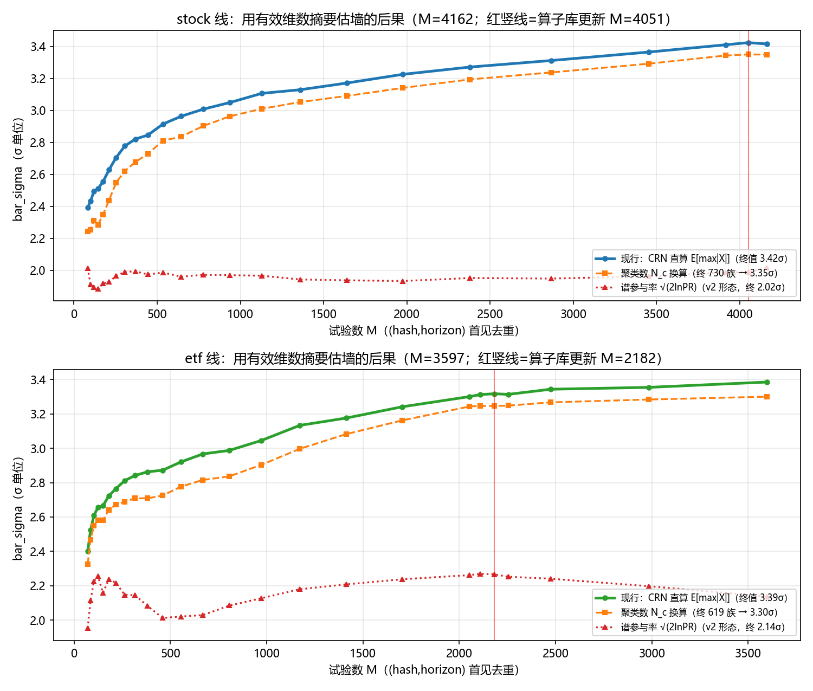
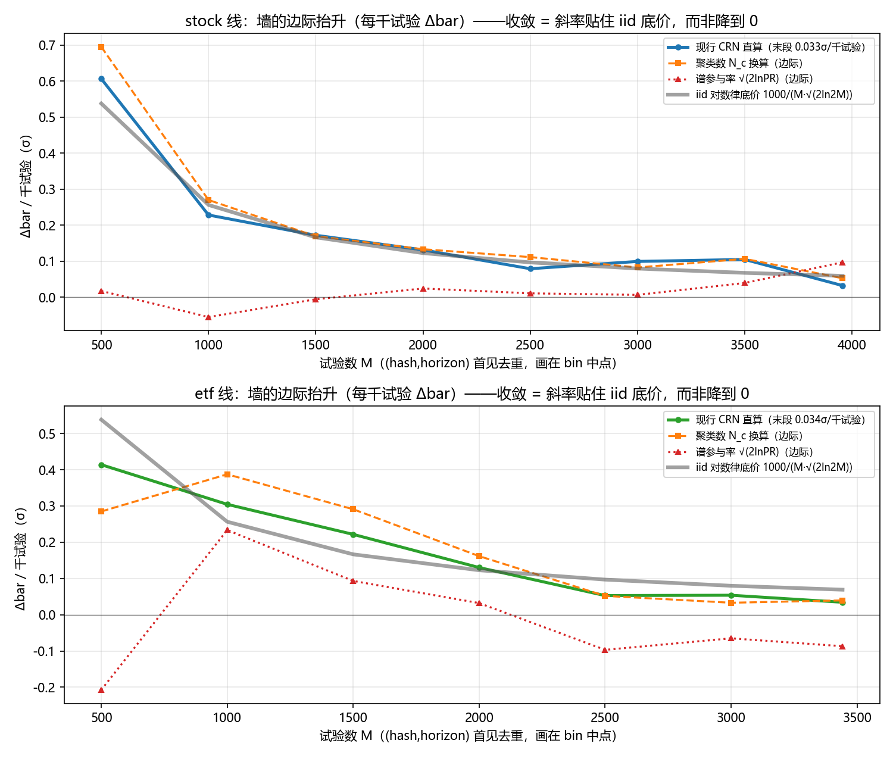
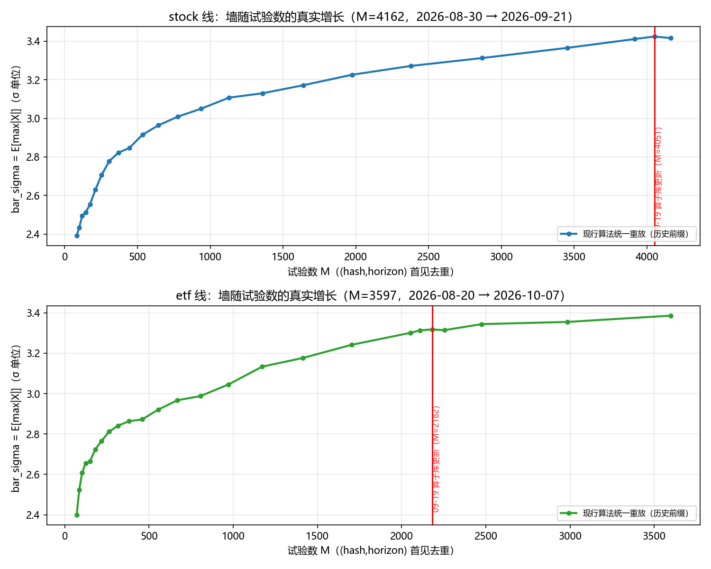
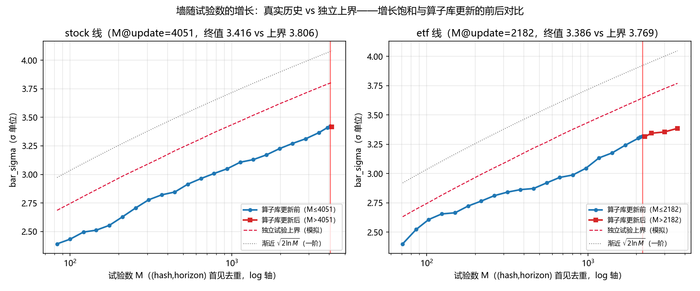
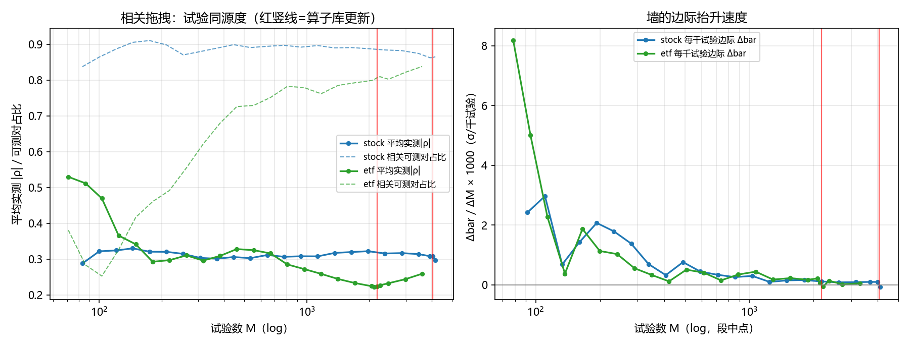

# 多重检验校正：业界/学界方法盘点、本地机制全推导、真实墙增长实证

- 日期:2026-10-07
- 任务来源:用户三问——①找出当初"其它项目/业界/学界为什么不采用多重检验校正"的调研文档（找不到则重做）；②写清本地多重检验校正的具体机制；③用**真实历史**给出墙（bar）随试验数的增长曲线，并把**随机树算子库更新（2026-09-19）前后标记出来**。
- 调研溯源结论:**未找到独立的"业界为什么不用多重检验校正"调研档**——既有材料是 [`REPORT-multiple-testing-evolution-2026-09-08.md`](REPORT-multiple-testing-evolution-2026-09-08.md)（自家机制的公式层演进史，业界仅零散引用）与 [`RESEARCH-random-search-space-expansion-2026-09-18.md`](../internal/RESEARCH-random-search-space-expansion-2026-09-18.md)（WorldQuant BRAIN 算子目录引用）。本文 §一 为补做的完整调研；§二 全部公式对照现行代码核验；§三 为生产状态上的历史重放（脚本与图见附录 A）。
- 数据口径:生产只读。stock=`~/.factor-mining-stock-h10c30`（M=4162，08-30→09-21）、etf=`~/.factor-mining`（M=3583，08-20→10-07 在跑）。
- 2026-10-08 重排:§二 按用户定夺的三段式重写——①因子生成架构 ②变量表 ③每种墙的定义与算法；新增尾轨 v2 墙小节（10-08 起现役）与退役口径速查表，公共数学（R 构造/CRN/EVT/t 检验）归位到使用处；原 2.1–2.8 的全部实证内容保留、仅重排。

---

## §0 摘要

1. **业界与学界几乎没有人做"教科书式"的多重检验校正**（对整族试验做 Bonferroni/Šidák 级别的 FWER 控制）。学界用事后补救（t>3 门槛、FDR、DSR），业界用**六条流程防线**代替统计校正——经济先验砍 M、样本外付税、成本过滤、方法论复制、组合增量条件检验、Sharpe 折减（§1.2 逐条给机制实质、统计等价物与失效模式）；**学界自动挖掘系统（RL/LLM/GP）与开源管线同样全部不校正**——评 IC/样本外切分，检索未见任何把校正接进挖掘循环的实例。根本原因五条：试验总数 M 不可观测、试验相关结构不可测、"家族"边界无法定义、全校正杀死发现率、以及业界把校正**推迟到实盘**（用钱付，而不是用阈值付）。
2. **本地系统是 DSR（Deflated Sharpe Ratio）血统的现代形态**：$sr_0=\bar\sigma\times\sigma_{\mathrm{pool}}$，其中 $\bar\sigma=E[\max_i|X_i|]$（$X\sim N(0,R)$）用 CRN 蒙特卡洛从**实测**试验相关矩阵直算——比 B-LP 原始版多出三件业界做不到的东西：M 机械记账（trail_engine）、R 逐对实测（sketch 尾对齐 Gram）、门自动化（fail-closed 硬门 + 分层计价）。
3. **真实历史证实墙的增长已接近饱和**：两根线的墙都停在独立上界的 **~90%**（bar/iid=0.898）；etf 线边际抬升从早期 ~2σ/千试验衰落到更新后 **0.054σ/千试验**。**09-19 算子库扩充（+17 算子）既没有抬升墙的增长率，也没有降低试验同源度**（平均实测 |ρ| 反而 0.222→0.259）——多样性瓶颈不在算子表，在叶子字段与共同市场模式。
4. **若按旧口径用 N_eff（有效维数摘要）估墙，三种形态三种死法（图 1 实测）**：谱参与率把墙**冻结在 ~2σ**（第 ~200 个试验后纹丝不动，终值低估 1.25~1.40σ）；聚类数 $N_c$ 当下凑巧接近但**非单调**——stock 实测两次随新试验下降（29→27、735→730 族），等于开出"刷同族变体洗墙"后门；线性 $N_{\mathrm{eff}}$ 反向高估 0.66σ、推墙超过 iid 数学上限。全矩阵 CRN 直算是唯一同时避开三条死路的形态。

---

## §一 业界与学界方法盘点

### 1.1 学界：两条线

**（a）因子动物园的事后清算线。** Harvey–Liu–Zhu（2016, RFS）盘点了 1967–2014 年发表的 **300+ 个截面因子**，指出每个都过了名义 t>2 的门槛，但"发表前已被数百研究者在本同一数据上搜索过"——用 Bayes 因子法控制已发表因子中的假发现比例后，新因子的门槛应提到 **t > 3.0**（其框架下 5% 水平的精确门槛 2.78，Feng–Giglio–Xiu 2020 沿用）。这是**最简形态的多重检验意识**：不用族校正，只把单试验门槛整体抬高。后续实证支持（数字核实）：McLean–Pontiff（2016，JF，82 个已发表因子）——组合收益**样本外 −26%**（这是数据挖掘效应的上界估计）、**发表后 −58%**（其中 32 个百分点归因于知情套利）：样本外的衰减本身就是"选择运气被带进样本外"的直接测量。Hou–Xue–Zhang（2020，RFS）系统复制 **452 个已发表异常**：按市值加权+NYSE 断点，**65% 过不了 |t|≥1.96，82% 过不了 t≥2.78**（HLZ 门槛）——学术界的"事后清算"把因子动物园杀掉了三分之二到五分之四。Jensen–Kelly–Pedersen（2023）用贝叶斯模型比较重审"复制危机"，发现所谓失败复制大半是模型设定差异而非假阳性——但对 t<2.8 的弱因子，假阳性占比确凿升高。Harvey（2017）主席演讲把这套归纳为对业界的直接建议：**对回测 Sharpe 打折（haircut）**。

**（b）回测过拟合的形式方法线。** 这条线**就是**多重检验校正的金融版，只是教科书很少这么讲：
- White（2000）Reality Check 与 Hansen（2005）SPA：对"从 K 个策略里挑最好"做 bootstrap 联合检验——本质是 $E[\max]$ 的置换版；
- Bailey–Borwein–López de Prado–Zhu（2014–2017）：**Deflated Sharpe Ratio**（把观测 SR 与"N 次试验下最幸运者的期望水平" $E[\max \mathrm{SR}]\approx\sigma_{\mathrm{SR}}\sqrt{2\ln N}$ 比较，再加偏度/峰度修正）、**PBO/CSCV**（组合对称交叉验证估计"样本内选优者样本外跑输中位数"的概率）、以及《pseudo-mathematics and financial charlatanism》的警示——数学内核与本项目现行墙**同宗**；
- 经典族校正（Bonferroni $\alpha_0=\alpha/M$、Šidák $\alpha_0=1-(1-\alpha)^{1/N_{\mathrm{eff}}}$、Benjamini–Hochberg FDR）在因子语境的使用集中在 Feng–Giglio–Xiu（2020）式的"新因子对既有因子 zoo 的增量检验"，而不是对挖掘全程的 running correction。

### 1.2 业界用什么对抗多重检验：六条不叫"校正"的校正

业界几乎不做显式族校正，但其流程处处是对选择偏差的**替代性防御**。逐条给出机制实质、代表使用者、统计等价物与失效模式——这才是"业界用什么对抗多重检验"的完整答案：

**防线一：经济先验（theory-first）——用先验砍掉 M 本身。**
机制：没有经济学机制的信号不进研究队列——限制的不是门槛而是**试验总数**。使用者：AQR 与传统基本面量化（"先讲清楚为什么，再去跑数"）；Cochrane 对 factor zoo 的著名批评（"t=3 只是从统计上 panic"）是这条线的理论表述。统计等价物：**隐性的 Bonferroni 减负**——把 M 从 10⁵ 量级压到 10¹~10² 量级，门槛问题自动消失。失效模式：机制叙事可以事后编（hindsight rationalization——先看到信号再补故事，先验形同虚设）；同一个先验下仍可挖出千百个变体，M 在"家族"内部静默膨胀。

**防线二：真样本外（holdout / paper trading / live）——把校正推迟，用时间付税。**
机制：数据物理隔离，验证期过去不回头；实盘小仓位起跑、达标再加。使用者：几乎所有基金的研究流程；BRAIN 的 OS 检验期。统计等价物：**一次额外的独立实验**——它不控制 FWER，而是用重复抽样去兑现有无运气。失效模式：**单次 OOS 仍是 5% 水平的检验**——在样本内挖过一千次的信号，被选中进入 OOS 的那个候选自带过剩运气（selection 被带进 OOS）；McLean–Pontiff 的 −26% 样本外衰减正是这个"带进"的测量。且 OOS 只有一次，看完就变成了样本内。

**防线三：交易成本与容量过滤——让假 alpha 死在经济层。**
机制：回测计入现实成本、冲击与容量上限；大量统计上"显著"的信号在成本层消失。使用者：Frazzini–Israel–Moskowitz（AQR，对文献因子×多市场系统计入交易成本）；所有实盘组合构建。统计等价物：一个与分布无关的第二判别器——**它与统计校正正交但同向**（假 alpha 的 IC 往往撑不起成本）。失效模式：对低换手、大容量的假信号无能为力；成本模型本身是可调参数，调成本也是一次试验（且通常不记账）。

**防线四：方法论复制（replication）——独立的系统性重复实验。**
机制：换加权方案、换微观结构清洗、换样本重跑别人的因子。使用者：Hou–Xue–Zhang（452 个异常 65%/82% 不复现）、Chen–Zimmerman（考虑微观结构偏误后大量异常消失）、Andrew Chen 的开源复制。统计等价物：**独立重复实验的工业版**——这是频率学派最诚实的武器。失效模式：只对**已发表**的因子可行；对各家私有在挖的信号没有任何人做复制——而这正是 M 与 R 不可观测的地方。

**防线五：组合增量（incremental value vs 存量 book）——对"已发现集"的条件检验。**
机制：新信号不看自身 Sharpe，看**加进存量组合后**是否改善样本外表现——不改组合就不要。使用者：系统化多信号基金的组合中台、alpha 池管理（新因子要跟存量几十上百个因子正交化后比增量）。统计等价物：**序列/条件多重检验**——每个新发现面对的条件 null 是"给定已发现集之后的残差"，这正是本系统正交门（对在册因子秩相关 ≥0.80 拒）的实盘原型。失效模式：条件检验的族错误率不透明（没人算过序列增量的 FWER）；且存量 book 本身可能是假的——条件检验继承污染。

**防线六：折减与缩水（haircut / shrinkage）——显式校正的便宜版。**
机制：对报告的 Sharpe/t 值按检索强度整体打折。使用者：Harvey–Liu 的 haircut Sharpe（Man/AHL 系采用的框架）；业内"回测 Sharpe 打五折"口诀；Jensen–Kelly–Pedersen 的贝叶斯复制权重。统计等价物：**一次性近似的多重检验校正**——t>3 就是 Bonferroni 在 M~数百时的量级；折扣=把整个挖掘史压缩成一个标量乘子。失效模式：N 不可知时折扣只能拍脑袋；折扣一次到位而挖掘在继续（静态校正 vs 动态墙）。

**两个与本系统形态最像的平台，深挖一步：**
- **WorldQuant BRAIN**的对抗=三件套：OS 检验期（防线二）+ 自相关 <0.7 对已提交 alpha（防线五的平假版）+ **只按 OS 表现付钱**（激励对齐——把假 alpha 的成本转回提交者）。漏的是同一个东西：投稿者**私下试了 300 个报 1 个**，平台看不到（M 不可观测），selection 只能转嫁给个人。
- **Numerai**的对抗=**风险转移型校正**：质押真金白银 + live 相关惩罚 + 按 live 表现（MMC）支付——假 alpha 不再是平台的假阳性，而是提交者自己的亏损。漏：live 期短、检验方差大，本质是小样本实验。

**小结**：业界的总策略是**把统计校正问题转化为流程与激励问题**——先验砍 M、OOS 付税、成本过滤、复制、组合条件检验、折减。每条都在一个维度上近似了族校正，但**没有一条同时做到四件事：M 全量记账、R 实测、族错误显式受控、自动执行**。这四件的合取才是本系统的墙——也是为什么它不能从业界流程里"借鉴"出来，只能从记账基础设施里长出来。

### 1.3 学界自动因子挖掘系统与开源项目：挖掘循环里同样没有校正

与 1.1 的"因子研究事后清算"不同，这一族是**自动挖掘系统**——生成器+评估器+循环，形态上与本系统最接近。逐一对表：

| 系统 | 类型 | 评估/验证形态 | 多重检验校正 |
|---|---|---|---|
| **AlphaGen**（KDD 2023, arXiv:2306.12964） | RL 生成公式化 alpha **集合**（组合协同优化） | RankIC + 组合增量收益，CSI300 train/test 切分（开源：ICT-FinD-Lab/alphagen，gplearn 作基线） | 无 |
| RiskMiner（KDD 2024）/ AlphaQCM / AlphaForge（2024） | 风险寻求 MCTS / 分布式 RL / 生成-预测动态组合 | IC/RankIC/ICIR + 回测 | 无 |
| **AlphaAgent**（2025, arXiv:2502.16789） | LLM agent + 正则化演化 | IC + 牛熊市回测（A 股）；"de-antibugging"抗 alpha 衰减 | 无 |
| AlphaBench（ICLR） | LLM 挖因子的系统评测基准 | IC/RankIC/ICIR + Qlib 回测 | 无 |
| **RD-Agent(Q)**（Microsoft 2025, arXiv:2505.15155） | 多智能体闭环：假设→写因子代码→**Qlib 回测验证**→迭代（开源，挂 Qlib 生态） | 回测+消融；宣称 2× 年化、因子数 −70% | 无 |
| GP 系（gplearn 基线 / WS-GP 热启动 / 层次遗传算法） | 遗传规划符号回归 | IC 适应度 + 简约性惩罚 + 样本外切分 | 无 |
| **mlfinlab**（López de Prado 书配套库） | **评估工具库，非挖掘管线** | 实现 DSR/PBO/CSCV | 本身就是校正——但没有挖掘管线把它接进循环 |
| alphalens（Quantopian） | 因子分析报告 | IC 分位数/换手/衰减 | 无 |

三个观察：

1. **评估形态高度统一且全部无校正**：单因子显著性（IC 量级）+ train/test 切分 + 组合回测。检索（AlphaGen/AlphaAgent/GP 系 × multiple testing/FDR/DSR/deflated）**未找到一篇把 Bonferroni/BH/DSR 接进挖掘循环的论文**——这是文献里明确承认的开放评测问题；现有批评也只到"多数 LLM 挖掘管线只按样本内表现奖励"（交易成本论文，SSRN）与"IC/RankIC 不足以判定真伪"（AlphaEval 2026）。
2. **它们不是不知道，而是接不上**：RL/LLM/GP 的奖励需要稠密、可比、代际平滑的标量（IC/适应度）；FWER 墙是不连续门槛，且候选代际间高相关使墙近乎冻结——接进奖励要么无梯度、要么无区分度。更深一层是工程性的：试验记账基础设施（trail/ledger/sketch 级别的 M 与 R 观测）在这些框架里根本不存在。
3. **最接近的既有物都游离在循环外**：mlfinlab 的 DSR/PBO 是"事后工具"，BRAIN 的自相关门是"平台门禁"。**在自动挖掘管线这个形态族里，未检索到第二个把 running correction 墙内化进循环的实例。**

### 1.4 为什么业界与学界挖掘系统都不采用经典校正

1. **M 不可观测。** Bonferroni/Šidák/DSR 的第一个输入是"总共试了多少"。研究者私下试了 500 个报 5 个，平台/期刊看到的 M=5。数据窥探在组织边界外不可记账——这是**根本障碍**，不是懒。
2. **R 不可测。** 试验间的相关结构需要保留每次试验的统计量序列并逐对计算。业界不留存（或根本没意识到要留存），于是只能用独立假设 → 校正要么过松（隐藏相关使有效 M 远小于名义 M 的倒数——不，方向反了：正相关使独立式校正**保守**，负相关使其失效），要么干脆放弃。
3. **"家族"无法定义。** 校正要求预先声明"这一批试验是一个族"。挖掘是连续过程，族边界任意——这正是本项目后来用"评估即记账 + 试验单元 (hash,horizon) 首见去重"机械解决而非定义解决的问题。
4. **全校正杀死发现率。** M~10⁵ 时 Bonferroni 门槛 ≈ Φ⁻¹(1−0.05/10⁵) ≈ 4.4σ，且这是对**单个**假设；对连续挖掘管线意味着永久停机。业界的生存理性：宁可事后用样本外验证杀掉假阳性（成本=一笔亏损策略），不用 5σ 门槛扼杀全部真发现（成本=错过整个 alpha）。
5. **校正被推迟到实盘。** 样本外/论文交易/小仓位试运行本质是"用真实时间和钱付校正税"。它比统计校正**更贵但无需 M**——这就是业界的选择。
6. **挖掘系统的奖励工程冲突（1.3 特有）。** RL/LLM/GP 管线的搜索信号需要稠密可比的适应度；FWER 墙是不连续门槛，候选代际间高相关又使墙几乎冻结——接进奖励要么无梯度、要么无区分度。该族群集体退到"IC + 样本外"是结构必然，不是疏忽。

### 1.5 本地系统在谱系中的位置

本地系统 = **DSR 血统 + 三件业界做不到的基础设施**：

| DSR 需要的输入 | 业界状态 | 本地系统 |
|---|---|---|
| 试验总数 M | 不可观测 | trail_engine.json 机械记账（评估即写，fail 也算） |
| 试验相关矩阵 R | 不可测 | sketch 尾对齐实测（v4 共同尾长一次 Gram） |
| 执行力 | 靠人自律 | fail-closed 硬门 + 永久 ledger + reset 硬拦 |

所以准确的回答是：**不是"别人不做校正所以我们也不做"，而是"别人做不了，因为 M 和 R 拿不到；我们恰好把这两样变成了机械事实，于是 DSR 从论文建议变成了可执行的墙。"** 分层计价（机制层只按注册试验定价）则是对 DSR "M 应该算谁"这一未定义问题的本地答案——业界文献里没有对应物。

补上 1.3 的坐标系：在自动挖掘管线族（AlphaGen/RD-Agent(Q)/GP 系）里，本系统未检索到第二个内化 running correction 的实例——这是**形态差异**（记账+实测+硬门在循环内），不只是程度差异（门槛更高）。

---

## §二 本地机制：架构、变量与墙

### 2.1 因子生成架构（管线五级 + 双轨 + 分层）

一面读本节需要先知道"一次试验"是什么：一个候选因子表达式在一个数据面板上被完整评估一次。管线五级：

**(1) 数据面板**。`data-config` 声明横截面面板（全A个股 / ETF 日线；字段 open/high/low/close/volume/amount）。环境指纹 = 数据内容哈希 + 口径哈希——只有同指纹的环境才共享 null 地形与墙（"研究家族 = env identity"：同一面板拆多个 stateRoot 稀释试验数 = 规避门禁，被纪律明令禁止）。

**(2) 候选生成（三源）**。
- **随机树**（主源）：算子库 61 个（时序 34 / 截面 6 / 二元 8 / 一元 10 / 比较 2 / 条件 1）作用于 6 个叶子字段，表达式深度 3–5，约束至少 1 个时序算子 + 1 个截面算子，窗口取自 {3, 5, 10, 20, 60, 120, 250}；另有模板通道（leg_weight / hedge_resid / window_spread / cond_gate，占比 0.3）。算子集进 null 指纹（opset_fingerprint）——扩算子库会改变 null 地形口径、强制重校准（09-19 扩表当天补上的静默漂移缝）。
- **机制自提**（mechanism）：模型先提出经济机制假设，按配额发射构造性试验（出身进机制层计价，§2.3.2）。
- **灵感源**（inspiration）：文献与概念碰撞卡。
生成侧防复读：trail_similarity / 新颖门查重。

**(3) 评估**（`factor_evaluate`，同一 train 窗口）：多 horizon 的 IC 序列 → $\mathrm{IC}_{\mathrm{IR}}$；尾部 top-N 价差诊断（spread_ir、高阶矩、持仓名单）；每个试验落两份指纹——IC 序列尾段 **sketch**（因子线相关结构的原料）与名单 **MinHash 指纹**（32 哈希 (day,asset) shingle，尾轨相关结构的原料）。

**(4) 记账与校准**。`trail_engine` 按 $(source\_hash, horizon)$ **首见去重**记账——评估成功即记一条（**verdict=fail 也算**：选择偏差发生在评估时刻，不在注册时刻）；重评不新增试验；带 sketch 的后见条目覆盖 sketch；test 区结果物理隔离不进账；确定性扰动（平坦性邻域）不进账（非选择试验）。null 地形：n=200 个随机树按同口径跑出 $\mathrm{IC}_{\mathrm{IR}}$ 经验分布，供 $\sigma_{\mathrm{pool}}$（§2.3.1）。

**(5) 门禁与入册**：G1 placebo（top-N 净超额 vs 随机选股，submit 侧权威重跑 m≥60）/ G2 噪声（日置换）/ **G3 deflation（=§2.3 的墙）** / 正交门（对在册因子逐日秩相关，$|\bar\rho|\ge0.80$ 拒、0.60–0.80 强制标注）。过门写入 registry 与 registered_ledger；孵化通道（样本外复活证据）是唯一豁免口，入册带标注可审计。

**双轨**：IC 轨（admit_basis=ic，判 $\mathrm{IC}_{\mathrm{IR}}$）与尾轨（admit_basis=tail，判 spread_ir）**独立账本、独立家族几何**（因子线用 sketch 相关，尾轨用名单 Jaccard——两种相关结构即两种墙的来源），dual_pass=双过（audit 实证仅 ~4/19 有区分度）。**分层**：全局层（全体试验）与机制层（推理型出身）分别计价（§2.3.2）。

### 2.2 变量表

| 符号 | 含义 | 取值 / 出处 |
|---|---|---|
| $M$ | 已试假设数（试验总数） | trail_engine，$(hash,horizon)$ 首见去重 |
| $\mathrm{IC}_{\mathrm{IR}}$ | 候选的信息比 $\bar{IC}/s_{IC}$ | train 窗 IC 序列 |
| $T$ | IC 序列长度 | 评估输出 |
| $\gamma_3,\gamma_4$ | IC 序列偏度 / 峰度（非超额） | 评估输出 |
| $\Phi,\bar\Phi$ | 标准正态 CDF / 生存函数；$z_q=\Phi^{-1}(q)$ | |
| $R$ | 试验相关矩阵（$M\times M$） | sketch 共同尾一次 Gram（§2.3.1 算法①） |
| $L$ | 两 sketch 共同尾长 | $\min(l_i,l_j)$；$L<60$ 的对不进 R |
| $\bar\sigma$ | 选择运气税：$E[\max_{i\le M}\lvert X_i\rvert]$，$X\sim N(0,R)$ | CRN 直算（§2.3.1 算法②） |
| $K$ | CRN 蒙特卡洛路径数 | 20 000，列种子固定（SEED=42） |
| $\sigma_{\mathrm{pool}}$ | null 下 $\mathrm{IC}_{\mathrm{IR}}$ 的离散度 | $(p_{90}-p_{10})/2.5631$，null 地形 |
| $sr_0$ | **IC 线全局墙**（$\mathrm{IC}_{\mathrm{IR}}$ 单位） | $\bar\sigma\times\sigma_{\mathrm{pool}}$ |
| $\alpha_{\mathrm{track}}$ | 单轨显著水平 | $1-\sqrt{0.95}\approx0.0253$（跨轨 Šidák，§2.4） |
| $s_0$ | null 下 spread_ir 的标准差 | 经验值 = landscape spread 段；兜底解析式 $1/\sqrt{n_{\mathrm{days}}}$ |
| $\mathrm{spread\_ir}$ | 尾轨统计量（top-N 价差 IR） | 评估尾块 |
| $N_{\mathrm{eff}}$ | 尾 v1 的"有效试验数" | 名单 Jaccard ≥ 0.25 的并查集连通分量数（§2.3.3） |
| $J,\ \Omega,\ c$ | MinHash Jaccard / 名单重叠率 / $k_{\mathrm{frac}}=K_{top}/N_{\mathrm{pool}}$ | 尾 v2 相关闭式（§2.3.4） |
| $M_{\mathrm{mech}}$ | 机制层试验数 | 注册台账 ∩ trail，∪ 台账独有 hash 合成独立单例 |
| $t_{\mathrm{adj}},\ p$ | 高阶矩校正 t 与 p 值 | §2.4 |

### 2.3 墙的定义与算法（每种）

一图速查（现行四道 + 退役三口径；**墙 = 该统计量域里"最幸运的 null 试验"的期望位置**，即对选择运气的定价）：

| 墙 | 统计量域 | E[max] 取侧 | 相关结构来源 | 状态 |
|---|---|---|---|---|
| IC 线全局墙 $sr_0$ | $\mathrm{IC}_{\mathrm{IR}}$ | 双侧 | sketch 实测 R | 现行硬门 |
| 机制层墙 $sr_0^{\mathrm{mech}}$ | 同上 | 双侧 | 层内子集 R | 自动轮（10-06 起） |
| 尾轨 v1 墙 | spread_ir | 单侧 | 名单并查集**计数** | **10-08 起退役**（36 只回收近失族） |
| 尾轨 v2 墙 | spread_ir | 单侧 | 名单重叠**相关矩阵** | **10-08 起现役** |
| 线性 / 谱 / 聚类（因子线历史口径） | — | — | $\bar\rho$ / 特征值 / 连通分量 | 已退役（§三 图 1 实测其死法） |

#### 2.3.1 IC 线全局墙（现行硬门）：$sr_0=\bar\sigma\times\sigma_{\mathrm{pool}}$

**定义**：

$$
\bar\sigma \;=\; E\Big[\max_{i\le M}\lvert X_i\rvert\Big],\qquad X\sim N(0,R),
\qquad
\boxed{\;sr_0=\bar\sigma\times\sigma_{\mathrm{pool}}\;}
$$

取双侧 $|\cdot|$ 是因为 agent 按 $|\mathrm{IC}|$ 挑最优、符号事后翻转也算选择（尾轨相反，准入规则单侧，见 §2.3.3/2.3.4）。$\sigma_{\mathrm{pool}}$ 完成 σ 单位 → $\mathrm{IC}_{\mathrm{IR}}$ 单位的量纲匹配。

**算法四步**（`_LuckSampler`，本节全部公式对照现行代码核验）：

**① sketch → 相关矩阵 $R$**。每个试验保留 IC 序列的尾段 sketch（同 train 窗口，尾部天然对齐）。对试验 $i,j$：共同尾长 $L=\min(l_i,l_j)$，$L<60$（`_MIN_ALIGN`）的对**不进 R**——零假设下 $L$ 点相关的噪声尺度 $E|r|\approx1/\sqrt L$（$L=20$ 时 ≈0.22），短重叠段的"相关"几乎全是噪声。合格 sketch 截到**公共尾长** $\min_i l_i$、中心化、归一化后**一次 Gram** $C=X_nX_n^\top$——单一 Gram 矩阵 PSD by construction，不依赖投影；**签名相关**（不取 abs）：$\pm$ 对 $E[\max|X|]$ 同价，符号携带族间抵消结构（动量↔反转）。缺测对：同 hash 跨 horizon 先验 → 否则 **0（按独立计）**——独立是 $E[\max|X|]$ 的最贵假设，缺证据=保守。
*事故链（为什么必须是这个形态，2026-09-13 v4 审计）*：旧实现逐对各取不同重叠段（互不一致 → 天然非 PSD：3662 试验的 R 带 1360 个负特征值）再 abs() 抹符号 → PSD 投影后残余伪共同因子（top 特征值占总质量 32%）→ $\bar\rho$ 0.165→0.267，墙被推到 4.58σ——超过 iid 上限 4.35σ，数学上不可能是诚实值（独立重算 3.35）。§三 图 1 里这次修复表现为 at_write 曲线 09-13 的垂直回落。

**② CRN 蒙特卡洛直算 $\bar\sigma$**。对 $R$ 特征分解 $R=V\Lambda V^\top$（负特征值 clip 到 $10^{-8}$ 的 PSD 兜底），$A=V\Lambda^{1/2}$，取 $K=20{,}000$ 条路径的独立标准正态列 $Z_j\in\mathbb R^K$（**固定种子** $\texttt{SEED}+1000j$），则

$$
X \;=\; Z\,A^\top \;\sim\; N(0,R)\quad(\text{逐行同分布}),\qquad
\hat{\bar\sigma}=\frac1K\sum_{k}\max_i\lvert x^{(k)}_i\rvert .
$$

新增一个试验时走**条件采样增列**（不扰动旧列）：新试验与旧试验的相关向量 $r$，分块协方差给出 $X_{m+1}\mid X_{1:m}\sim N(X_{1:m}R_m^{-1}r,\ 1-r^\top R_m^{-1}r)$，实现为 $x_{new}=Xv+\sqrt{s}\,z_{new}$（$v=R^{-1}r$，$s=1-r^\top v$；非 PD 增长 $s\le10^{-8}$ → 全量重建）。增量 $O(M^2)$，重建 $O(M^3+KM)$，千级试验秒级。
**单调性定理（防灌水的正确性保证）**：试验集 $B\supseteq A$ ⇒ 逐路径 $\max_{i\in B}|X_i|\ge\max_{i\in A}|X_i|$ ⇒ $\bar\sigma$ 对 $M$ 单调不减——耦合定理的直白推论，非数值补丁；它保证"加入候选不会压低运气基线"，也使 v4 审计得以摘除旧包络（`bar_sigma_at_write` 只落盘作审计轨迹，不回读进门）。边界：$M=0\Rightarrow0$；$M=1\Rightarrow E|Z|=\sqrt{2/\pi}\approx0.798$（冷启动即有选运底价：连符号都是选出来的）。副产物零成本：$p_{\mathrm{fw}}(z)=P(\max|X|\ge z)$（诊断字段）、$\nu_i=1/\mathrm{diag}(R^{-1})_i$（试验残差方差占比——多样性遥测）。

**③ 乘 $\sigma_{\mathrm{pool}}$（量纲匹配与污染防护）**。$\bar\sigma$ 是 σ 单位，观测统计量 $|\mathrm{IC}_{\mathrm{IR}}|$ 的 null 离散度由截面决定，故取**指纹校验后的 null 地形分位数**（n=200）：

$$
\sigma_{\mathrm{pool}}=\frac{p_{90}-p_{10}}{2.5631},\qquad 2.5631=2z_{0.90}
$$

（正态下 $p_{90}-p_{10}=2z_{0.90}\sigma$ 反解。）*为什么 landscape-only（v4 事故）*：曾用 trail 实测 std——amihud 族真信号入 trail 后把 $\sigma_{\mathrm{pool}}$ 抬 70%（0.179→0.304）→ 真因子被拒。用成功证据拓宽 null = 选择成功惩罚选择成功，方向反了；现行只取指纹门后的 null 地形 + 探测器（$s_{\mathrm{trail}}/\sigma_{\mathrm{landscape}}\ge1.5$ 报警不进门）。

**④ 现行读数**：stock $\bar\sigma=3.416$（$M=4162$）× 0.2688 → $sr_0\approx0.92$；etf $3.383$（$M=3583$）× 0.1807 → $\approx0.61$。判定路径（$t_{\mathrm{adj}}$、p 值）见 §2.4。

#### 2.3.2 机制层墙：同算法、换试验集

$sr_0^{\mathrm{mech}}$ 与 §2.3.1 **同一算法**（同一 $\bar\sigma$ 采样器、同一 $\sigma_{\mathrm{pool}}$），只换试验集：$M_{\mathrm{mech}}$ = 注册台账 ∩ trail，∪ 台账独有 hash 作**无 sketch 合成独立单例**——独立=最贵假设，保证 `state.reset` 删 trail 后层墙只升不降（堵 reset 塌缩）。现行读数（10-06 审计）：stock 2.090σ@$M_{\mathrm{mech}}$=63、etf 2.770σ@508，对比全局层 3.416σ@4162 / 3.383σ@3583。**出身=第三计价轴**：随机农场出身的 96% 试验不再让推理型假设替它们交税（影子→人审回扫→自动轮三阶段，急停 enabled 归零回人审）。

#### 2.3.3 尾轨 v1 墙（已退役）：族计数式

**定义**：

$$
\mathrm{bar}_{v1}=E[\max X](N_{\mathrm{eff}})\cdot s_0+z_{1-\alpha_{\mathrm{track}}}\cdot s_0
\qquad(\text{单侧})
$$

单侧的理由：准入规则 $\mathrm{spread\_ir}\ge\mathrm{bar}$ 本就只奖励正尾。**算法**：①每试验的 top-N 持仓名单落 MinHash 指纹（32 哈希 (day,asset) shingle）；②两两 Jaccard $\ge0.25$ 连边；③并查集连通分量数即 $N_{\mathrm{eff}}$；④$E[\max X](N_{\mathrm{eff}})$ 用 B-LP 单侧 iid 模拟估计量。

**三重病（2026-10-07 出身审计实测，退役依据）**：**链式**——相关性不可传递（$|\rho_{AB}|=|\rho_{BC}|=0.25$ 时 PSD 允许 $|\rho_{AC}|$ 近零），传递闭包却强加传递：巨连通内 86% 的对低于边阈值；**巨连通**——etf 99% 试验并入单分量 → $N_{\mathrm{eff}}=18/2797$，计数塌缩；**定义敏感**——并查集 vs 贪心代表制的族数差 +1244%。根源都是把依赖结构压缩成标量**计数**。**10-08 处置**：回扫重判后 36 只在册因子按 v2 不过墙，回收进近失族（`rescinded_tail_v2`——不再是注册成功态）。

#### 2.3.4 尾轨 v2 墙（现役）：名单重叠即相关

**核心闭式**（null 下 top-K 等权组合对池等权基准的价差统计量、iid 特异分量假设；推导见 `DESIGN-tail-wall-v2-2026-10-07.md` §1）：

$$
\rho_{ij}=\frac{\Omega_{ij}-c}{1-c},\qquad c=k_{\mathrm{frac}}=\frac{K_{top}}{N_{\mathrm{pool}}},\qquad
\Omega=\frac{2J}{1+J}
$$

$\Omega$=两名单时间平均重叠率，由 MinHash Jaccard $J$ 单调换算（等基数近似）。**边界自检**：同名单 → $\rho=1$；随机重叠（$\Omega=c$）→ $\rho=0$（**随机基线自动校正**——朴素 Jaccard 会系统性高估）；不相交 → $-c/(1-c)$ 微负互补 → **clip 0**（负结构对 $E[\max X]$ 二阶小、大面积负值伤 PSD，保守丢弃）。异 $k_{\mathrm{frac}}$ 成对取 $c_{ij}=\sqrt{c_ic_j}$。环境修正 $(a,b)$（a=斜率理论 1、b=同市场环境残余相关理论 ≈0）：$\rho\leftarrow\mathrm{clip}(a\,\rho+b,0,1)$，null 校准拟合排队中（P2），缺省理论值。

**算法四步**（`tailwall.py`）：①签名阵 → 分块两两一致率得 $J$ → $\Omega$ → $\rho$；②**PSD 投影**：对称化 + 特征值 clip 到 **0** + 对角重标定 $r_{ij}/\sqrt{d_id_j}$（不能 clip 到 $+\varepsilon$——那是正向注入方差：影子期实测把 $E[\max X]$ 抬 +0.24σ 超过 iid 上界，被上界哨兵当场抓住）；③**单侧 CRN**：§2.3.1 算法②的 `_LuckSampler` 单侧子类，外部 R **一次装载、前缀取值**（`emax_prefix`）——逐前缀全量重建会破坏 CRN 特征基嵌套，桥接攻击回归实测会降墙（0.2167→0.2115）；④$\mathrm{bar}_{v2}=E[\max X]\cdot s_0$（判定进 WS4 矩修正 $t$ 路径，§2.4；$s_0$ 经验值=landscape spread 段，兜底 $1/\sqrt{\text{采样期中位数}}$）。

**三哨兵**（每次提交自检，stderr 可见）：上界（$E[\max X]\le$ iid 精确模拟——抓 R 构造/投影数学 bug）、单调（台账只增墙不得降，容差 0.02σ）、接线（生效门值 = v2 计算值——抓接线回归）。**影子→现役读数**：etf v2 墙 0.7252 vs v1 塌缩值 0.5245；回扫四桶 0/8/20/8；10-08 起生产生效（开关 `tail_wall_v2`）。

#### 2.3.5 退役口径（因子线墙的三代史）

| 口径 | 换算 | 实测死法（§三 图 1） |
|---|---|---|
| 线性 $N_{\mathrm{eff}}=1+(M-1)(1-\bar\rho)$ | iid $E[\max\lvert Z\rvert](N_{\mathrm{eff}})$ | 反向高估 0.66σ，推墙过 iid 数学上限 |
| 谱参与率 $PR=(\sum\lambda)^2/\sum\lambda^2$ | $\sqrt{2\ln PR}$ | 墙冻结 ~2σ（第 ~200 个试验后纹丝不动，终值低估 1.25–1.40σ） |
| 聚类数 $N_c$（$\lvert\rho\rvert\ge0.6$ 连通分量） | iid $E[\max\lvert Z\rvert](N_c)$ | 非单调=洗墙后门（stock 实测两次随新试验下降） |

因子线现行=全矩阵 CRN 直算（§2.3.1）。历史澄清：因子线从未被聚类数定过价（线性→谱→CRN 三代）；用族数计价的是尾轨 v1（§2.3.3，已退役）。

### 2.4 从墙到 p 值：判定路径

墙（$sr_0$ 或 $\mathrm{bar}$）只是基准线，判定走**高阶矩校正 t 检验**。对 $\widehat{\mathrm{SR}}=\hat\mu/\hat\sigma$（IC 轨即 $\widehat{\mathrm{IC}}_{\mathrm{IR}}$，尾轨即 $\mathrm{spread\_ir}$，$sr_0$ 换成对应的 emax·$s_0$），对 $(\mu,v=\sigma^2)$ 用 delta method，$\nabla g=(v^{-1/2},-\tfrac12\mu v^{-3/2})$、样本矩协方差 $\frac{\sigma^2}{T}\big(\begin{smallmatrix}1&\gamma_3\\ \gamma_3&\gamma_4-1\end{smallmatrix}\big)$：

$$
T\,\mathrm{Var}(\widehat{\mathrm{SR}})
=\nabla g\,\sigma^2\begin{pmatrix}1&\gamma_3\\ \gamma_3&\gamma_4-1\end{pmatrix}\nabla g^\top
=1-\gamma_3\mathrm{SR}+\tfrac14(\gamma_4-1)\mathrm{SR}^2,
$$

（逐项：$1$；$-\gamma_3\mathrm{SR}$；$\tfrac14\mathrm{SR}^2(\gamma_4-1)$。高斯收益退化回 Lo (2002) 的 $(1+\mathrm{SR}^2/2)/T$。）于是

$$
t_{\mathrm{adj}}=\frac{(\widehat{\mathrm{IC}}_{\mathrm{IR}}-sr_0)\sqrt{T-1}}{\sqrt{1-\gamma_3\widehat{\mathrm{IC}}_{\mathrm{IR}}+\frac{\gamma_4-1}{4}\widehat{\mathrm{IC}}_{\mathrm{IR}}^2}},
\qquad
p=\bar\Phi(t_{\mathrm{adj}}).
$$

**门逻辑（fail-closed）**：$p>0.05$ → red_flag → 准入拒绝；$\bar\sigma>0$ 而无 $\sigma_{\mathrm{pool}}$ → 拒绝给 p（算不出校正就不准入，不给不可信数字）；永久 ledger 落盘每次门参数（只取证，不做门输入）。

**跨轨 Šidák**（全项目唯一显式 FWER 设计）：IC 轨与尾轨独立账本、独立家族几何（尾轨名单 Jaccard 的估计精度：$E[\hat J]=J$，$\mathrm{Var}=\frac{J(1-J)}{k}\le\frac1{4k}$），双轨各跑 $\alpha_{\mathrm{track}}$ 使全局 $1-(1-\alpha_{\mathrm{track}})^2=\alpha$：

$$
\alpha_{\mathrm{track}}=1-\sqrt{1-\alpha}=1-\sqrt{0.95}\approx0.0253.
$$

**对偶结构**：时间维运气（deflation，§2.3 的墙）× 横截面冗余（正交门：对在册因子逐日秩相关 $\bar\rho$，$|\bar\rho|\ge0.80$ 拒、0.60–0.80 强制标注——对"账本有效维度"定价，与"试验次数"定价互余）；机制层（§2.3.2）是第三轴。

### 2.5 理论背景一页：墙为什么长这样、为什么必然饱和

$M$ 个 iid 标准正态的最大值：$\Pr(T_{(M)}\le x)=\Phi(x)^M$。取 $x=u_M+y/u_M$、$u_M=\Phi^{-1}(1-1/M)$，用 Mills 比 $M\varphi(u_M)\to 1$ 得 Gumbel 极限 $\Pr(T_{(M)}\le x)\to\exp(-e^{-y})$（均值 $\gamma\approx0.5772$），且

$$
u_M=\sqrt{2\ln M}-\frac{\ln\ln M+\ln 4\pi}{2\sqrt{2\ln M}}+o\!\big((\ln M)^{-1/2}\big),
\qquad
E[T_{(M)}]=u_M+\frac{\gamma}{u_M}+o(1)\;\approx\;\sqrt{2\ln M}.
$$

本项目统计量是双侧的（agent 按 $|\mathrm{IC}|$ 挑最优，符号事后翻转也算选择），尾事件数约 $2M$，故 $E[\max|X|]\approx u_{2M}+\gamma/u_{2M}$。修正项不可省：$M=10^4$ 时 $\sqrt{2\ln M}=4.29$ 而修正值 4.00。**相关结构修正**：可交换相关下精确分解 $X_i=\sqrt\rho\,F+\sqrt{1-\rho}\,\varepsilon_i$ 给出

$$
E[\max_i|X_i|]=\sqrt{1-\rho}\;E[\max_i|\varepsilon_i|],
$$

即平均相关 $\bar\rho$ 是墙的"折扣率"：$\bar\rho\to1$ 墙冻结在 $\sqrt{1-\rho}\,\sqrt{2\ln(2M)}$，$\bar\rho\to0$ 墙抵达独立上界。这就是 §三 中两根线稳定停在独立上界 ~90% 处的机理。

**必须增长**：不校正时族错误率 $\mathrm{FWER}=1-(1-\alpha_0)^M\to1$；墙 $sr_0\propto E[\max|X|]$ 是使"最幸运 null 试验"的期望位置恰被定价的唯一量——它随 M 的增长就是校正本身。

**必然饱和**：一阶项 $\sqrt{2\ln M}$ 是对数律——M×10 只买 +0.5~0.6σ；且实测相关把墙压在独立上界之下（上式的 $\sqrt{1-\bar\rho}$ 折扣），新试验若与旧的同源（大多数如此），对墙的边际贡献趋近于零。**推论（反直觉）**：墙对"真新意"收费、对"复读"几乎免费——正交新试验抬墙最多，同族复写几乎不抬（复写另有正交门在入册口拦截）。§三 用真实历史验证这两条。

---

## §三 真实历史上的墙增长（生产数据重放）

### 3.1 数据与双口径

- **口径 A（引擎真实落盘）**：每条 trail 条目带 `bar_sigma_at_write`——当时引擎算出的墙值。含 09-13 前旧 R 构造的方法论偏移（含污染期）。**本文所有图表不使用此口径**（只随 JSON 存档备查——其 09-13 前的段落被 R 构造缺陷污染，不可作增长证据）。
- **口径 B（统一重放）**：用**现行 v4 算法**在历史前缀上全量重放（试验集合语义逐行复刻：$(hash,horizon)$ 首见去重、sketch 后见覆盖；CRN 同种子 $K=20{,}000$，终点值精确复现引擎落盘：stock 3.416 ↔ at_write 3.4161）——把方法论演进从真实增长中剥离。
- **算子库更新**：`22bf431c`（09-19，第一批）+ `55b8c6c1`（09-19，第二批 17 算子：加权/回撤区间/稳健统计/持续性/共矩/变换族），算子池 36→53。同日修复了"null 指纹不含算子集"的静默漂移缝（扩算子前墙口径本会漂）。更新位置：stock M=4051/4162（**97%**，两天后停线，更新后窗口 111 试验）；etf M=2182/3583（**61%**，更新后 1401 试验，对比充分）。
- **旧口径对照**（图 1 用）：同一批重放检查点上同步计算谱参与率 $PR=(\sum\lambda)^2/\sum\lambda^2$（R 特征值）、聚类数 $N_c$（sketch 相关 $|\rho|\ge0.6$ 并查集连通分量，只连实测对，缺测=自成一族）与线性 $N_{\mathrm{eff}}=1+(M-1)(1-\bar\rho)$，按旧公式换算墙值（$E[\max|Z|](N_c)$ 同 iid 模拟估计量、$\sqrt{2\ln PR}$）与现行 CRN 直算对照。**历史澄清**：因子线的墙从未被聚类数定过价（线性→谱→CRN 三代）；现役用族数计价的是**尾部线**（`tailgate.tail_n_eff`：名单 MinHash-Jaccard≥0.25 的并查集连通分量，bar $=E[\max X](N_{\mathrm{eff}})\cdot s_0+z\cdot s_0$ 单侧）——图 1 橙线是其**同构演示**（传递闭包结构相同，相似度空间换成因子线试验的 sketch 相关）。

### 3.2 图

**图 1：用有效维数摘要估墙的后果——旧口径 vs 现行口径**（上 stock / 下 etf；粗线=现行 CRN 直算；橙虚线=聚类数 $N_c$ 换算 $E[\max|Z|](N_c)$——尾部线同构的计数式形态（尾部线真身=名单 Jaccard@0.25 的并查集连通分量，此处以 sketch 相关@0.6 演示，见 §3.1 历史澄清与 NOTE 文档）；红点线=谱参与率 $\sqrt{2\ln PR}$——v2 因子线 08-21 前真用过的形态；红细竖线=算子库更新）：



**终值对照**：

| 口径 | stock（M=4162，诚实墙 3.416σ） | etf（M=3597，诚实墙 3.386σ） | 定性 |
|---|---|---|---|
| 谱参与率 $\sqrt{2\ln PR}$（PR=7.6 / 9.8） | **2.02σ（低估 1.40σ）** | **2.14σ（低估 1.25σ）** | 墙冻结 |
| 聚类数 $N_c$（730 / 619 族） | 3.35σ（低估 0.07σ） | 3.30σ（低估 0.09σ） | 当下凑巧，结构上错 |
| 线性 $N_{\mathrm{eff}}=1+(M-1)(1-\bar\rho)$（4112 / 3517） | 4.08σ（高估 0.66σ，超 iid 上限 3.81） | 4.04σ（高估 0.65σ） | 反向过严 |
| **现行 CRN 直算** | **3.416σ** | **3.386σ** | 完整几何+单调保证 |

三个后果（与图中三种形态一一对应）：

1. **墙冻结（谱式，低估 → 门常开）。** 可交换相关下 $PR\to1/\rho^2$、与 M 无关——有效维数摘要天然饱和。精确恒等式（一行代数）：trace$(R)=M$、trace$(R^2)=M+2\sum_{i<j}\rho_{ij}^2$ 给出

$$
PR=\frac{M^2}{M+2\sum_{i<j}\rho_{ij}^2}=\frac{M}{1+(M-1)\bar\rho_2},\qquad \bar\rho_2\equiv\text{全部对的平均平方相关（缺测按 0）}，
$$

   即**谱参与率归根结底只是平均平方相关的倒数**（stock 的 PR=7.6 ⟺ $\bar\rho_2$=13.2%），与 09-08 报告 §1.3 的设计效应式 $M_{\mathrm{eff}}^{\mathrm{deff}}$ 精确同物。实测 PR 曲线从第 ~200 个试验起完全平坦（stock 全程 1.9~2.0σ）：此后近 4000 个试验，校正一分未涨。用 2σ 墙判 4162 个试验挑出的最大值，等于给纯运气发通行证（运气本身就该被定价到 3.4σ）。这是 v3 退役谱换算的定量复核：09-08 报告记载的生产实测低估是 3.4×（含 abs/PSD 事故放大）；用现行干净 R 重放，纯理论低估也有 1.25~1.40σ（≈40%）。**谱式同样非单调**：由恒等式，PR 下降 ⟺ $\bar\rho_2$ 上升——灌高相关变体直接抬 $\bar\rho_2$ 压 PR 压墙（图 1 etf 红点线 m≈200→500 的下沉即实测：早期高相关家族 + 测量覆盖从 0.25 扩到 0.8 把缺测对"从 0 变实测"，$\bar\rho_2$ 跳升）。
2. **墙可被洗（聚类数的非单调性 = hacking 后门）。** stock 线实测到两次 $N_c$ 下降：m=121→145 时 29 族→27 族；m=4051→4162 时 735→730 族——**新试验把既有族合并，墙反而下降**。这直接违反"加试验只能抬墙"的单调性（CRN 单调性定理的原始动机即"防加入候选反而压低运气基线"）：用聚类数估墙等于给"刷同族变体洗墙"开绿灯——灌一批高相关变体把族合并 → $N_c$ 掉 → 墙掉 → 候选趁低入册。附赠聚类阈值（0.6）刀锋导致的墙跳变。且"族=连通分量"的定义本身就不成立——**相关性不可传递**（$|\rho_{AB}|=|\rho_{BC}|=0.6$ 时 PSD 约束允许 $|\rho_{AC}|$ 低至 0.28 以下）：实测最大连通分量吞掉全池 81~82%（stock 3390/4162）、**族内对过半 $|\rho|<0.3$（近零相关）**、换成引擎贪心代表制定义族数立刻 +37~45%——计数式估计的三重病（链式、巨连通、定义敏感）全被数据证实。连带发现：尾部线现役的 `tail_n_eff` 正是同构的传递闭包且阈值更弱（Jaccard 0.25），其 N_eff 低估风险是结构性的。**后续（同日）**：设计+任务书+影子落地见 [`DESIGN-tail-wall-v2-2026-10-07.md`](../../analysis/glm_mining/DESIGN-tail-wall-v2-2026-10-07.md)（名单重叠即相关 v2）与 [`PLAN-tail-wall-v2-and-rescan-2026-10-07.md`](../../analysis/glm_mining/PLAN-tail-wall-v2-and-rescan-2026-10-07.md)（开关默认关+回扫卡片+防复发七条；影子结果：etf v2 墙 0.7252 vs v1 塌缩 0.5245，四桶 0/8/20/8，快照漂移假设否证——`analysis/glm_mining/tail_rescan_v2/summary.md`）。
3. **几何信息丢失（聚类数当下为什么"凑巧准"）。** $N_c$=730 → 3.35σ 与诚实值只差 0.07σ，但这是当前族结构下的巧合而非正确：它把"族间相关"（族与族之间仍有 0.2~0.3 相关，$E[\max]$ 因此被压低）与"族内冗余"（同族几乎同臂，max 只在族间竞争）两种几何效应错误地折叠成一个计数。ρ 结构一变——比如未来算子库真把多样性提上去、$\bar\rho$ 下降——$N_c$ 换算立刻向 iid 上界漂移而过严，谱式则纹丝不动地停在 2σ。只有全矩阵 CRN 直算两种效应都吃对，且单调性由耦合定理保证、饱和由对数律自然给出。

一句话：**有效维数摘要（谱、聚类、线性式皆然）丢掉的恰恰是 $E[\max|X|]$ 的全部输入——相关矩阵的完整谱排布。** 低估型（谱）让校正从第 200 个试验起形同虚设；高估型（线性）把墙推过数学上限；非单调型（聚类）开出洗墙后门。

**图 1c：图 1 的导数视角——墙的边际抬升（2026-10-08 补）**（上 stock / 下 etf；纵轴=每千试验 Δbar，画在 500 步 bin 中点；灰粗线=iid 对数律解析底价 $\frac{\mathrm{d}}{\mathrm{d}M}\sqrt{2\ln(2M)}=1000/(M\sqrt{2\ln 2M})$；均匀检查点重放、CRN $K=4000$）：



**读数（"墙是否趋于收敛"的正面回答）**：收敛发生在**导数**上，不在水平上——水平曲线（图 1/图 2）在线性轴一个数量级窗口内近似直线，天生看不出对数律的减速。三条线三种答案：

1. **CRN（现行）：收敛到数学底价，不是收敛到 0。** 边际从 0.4–0.6σ/千阶梯衰减，$M\gtrsim2500$ 后贴住 iid 底价线（末段 stock 0.033 / etf 0.034σ/千，同位置底价 ≈0.06——贴底甚至略低于底价，因 $\bar\rho$ 仍在微升、折扣加深）。底价不为零是极值对数律的数学要求：**水平永不收敛也不应收敛——可收敛的墙可被刷穿**；运营换算：再挖一倍历史门槛税只加 ~0.2σ ≈ 0.03–0.04 IC_IR。
2. **谱参与率：躺平在 0 是失灵，不是收敛。** 其边际全程在 0 附近抖动，etf 后段为**负**（"墙随试验变矮"——洗墙后门在导数视角一目了然）。校正是否健康，看图 1 的水平曲线分不出来，看这张图立刻分出来。
3. **聚类数：形状相近是巧合，非单调是本性。** etf 末段边际降到 CRN 之下（墙增速被低估）——族合并时它连"只升不降"的基本资格都没有。

**图 2：墙随试验次数 M（纯重放口径）**（上 stock / 下 etf；唯一曲线=现行算法在历史前缀上的统一重放；红竖线=09-19 算子库更新所在的试验位置）：



曲线全程平滑且单一口径——方法论演进（含 09-13 R 构造缺陷及其修复；事故期 at_write 一度被推到 4.58σ，超 iid 上限 4.35）已从增长叙事中剥离。引擎逐条落盘的 `bar_sigma_at_write` 不作图，只随 JSON 存档备查（§3.1 口径 A）。

**图 3：墙随试验数 M vs 独立上界**（log 轴；蓝=更新前，红方块=更新后，红虚线=独立上界同估计量模拟，灰点线=$\sqrt{2\ln M}$ 一阶渐近）：



**图 4：相关拖拽与边际抬升**（左：平均实测 |ρ| 与可测对占比；右：每千试验边际 Δbar；红竖线=算子库更新）：



### 3.3 读数

| | stock | etf |
|---|---|---|
| 条目数 / 唯一试验 M | 4177 / **4162** | 3660 / **3583** |
| 时间跨度 | 08-30 → 09-21（停线） | 08-20 → **10-07（在跑）** |
| bar 起点 → 终点（σ 单位） | 2.41@83 → **3.416** | 2.41@71 → **3.385** |
| 独立上界（同估计量模拟） | 3.806 | 3.769 |
| **bar / 独立上界** | **0.898** | **0.898** |
| 平均实测 \|ρ\|（终值） | 0.297 | 0.259（更新前 0.222） |
| 相关可测对占比 | 0.87 | 0.84 |
| **算子库更新位置** | M=4051（97%，后窗仅 111） | M=2182（61%，后窗 1401） |
| 更新前边际抬升（尾部段） | 0.09σ/千试验 | 0.18σ/千试验 |
| 更新后边际抬升 | ≈0（窗口太短） | **0.054σ/千试验** |

### 3.4 三个发现

**（1）增长饱和被真实数据证实，且两线收敛到同一比值。** 全部历史挖完 4000+ 试验，墙从 2.4σ 走到 3.4σ（+1.0σ），而独立假想世界要走 3.8σ——墙停在独立上界的 **89.8%，两根线完全一致**（$\bar\rho$ 折扣的几何均值效应）。边际抬升已衰减到 etf 更新后 **0.054σ/千试验**：再挖 10 倍试验（→M≈36000），按当前轨迹墙大约再抬 0.3~0.5σ。"墙的棘轮会掐死管线"在数据上不成立；但对称地，**等也不会让墙自己松**——它已站在均衡高度（$\sqrt{1-\bar\rho}\,E[\max|\varepsilon|]$），能动的杠杆是"什么算一次试验"（层）与池宽，不是时间。

**（2）09-19 算子库扩充：墙没有加速，同源度没有下降。** etf 线更新前尾部边际 0.18σ/千 → 更新后 0.054σ/千（对数饱和继续主导）；平均实测 |ρ| 更新前 0.222 → 更新后 0.259（**微升**）。解释：新增 17 个算子仍在同样的 6 个叶子字段（o/h/l/c/v/amount）与同一市场共同模式上表达，算子表的多样性**没有**转化为试验统计量的多样性；且对墙而言"复读免费"——若新算子产物与旧试验高相关，墙几乎不抬（同时它们会被正交门拦在入册口）。**结论：多样性瓶颈不在算子表，在叶子字段与共同市场分量**——扩充搜索空间的下一杠杆是数据面（新字段/新横截面），不是结构词表。这与 09-18 调研"墙自动升高（经济学）"的预判方向相反：实测是"墙几乎没动，冗余由正交门买单"。

**（3）stock 线的 09-21 停线使更新后窗口只有 111 试验**，stock 侧的更新前后对比不具统计力（图中近乎竖直的红线段）；etf 线是唯一有效样本。若重启 stock 线挖掘，图 2 的曲线会自然给出第二份证据。

---

## §四 结论

1. **当初问题的准确表述**：不是"业界为什么不用多重检验校正"，而是"业界为什么**用不了**"——M 与 R 不可观测。学界因此退而求其次（t>3、FDR、DSR 论文），业界因此用相关门+样本外代替。本系统把 M、R 变成机械事实后，DSR 从文献建议变成了自动硬门——这是谱系中最严格的一档，不是另起炉灶。
2. **机制一句话**：$p=\bar\Phi\big((|\mathrm{IC}_{\mathrm{IR}}|-\bar\sigma\sigma_{\mathrm{pool}})\sqrt{T-1}/\sqrt{1-\gamma_3\widehat{\mathrm{IC}}_{\mathrm{IR}}+\frac{\gamma_4-1}{4}\widehat{\mathrm{IC}}_{\mathrm{IR}}^2}\big)$，其中 $\bar\sigma=E[\max|X|]$（$X\sim N(0,R_{\text{实测}})$，CRN 直算、单调有保证），$\sigma_{\mathrm{pool}}=(p_{90}-p_{10})/2.5631$ 取 null 地形——每一步都对应一次真实生产事故的修复（√(lnN) 系数、n_trials 恒 1、尺度错配、pool 污染、R 非 PSD、包络棘轮）。
3. **墙的增长已由数据定案**：两线 bar/iid=0.898、etf 边际 0.054σ/千试验——棘轮恐惧不成立，等待换宽松也不成立；杠杆在层定义与池宽（分层计价线正是为此而设）。**算子库扩充被实证为"墙中性"**：扩表不抬墙、不降同源度——下一次搜索空间扩张应投数据面。

## 附录 A：复现

```bash
cd analysis/glm_mining
python bar_growth_replay.py    # 只读生产 trail_engine.json，重放 ~10 分钟（K=20000 全精度）
python bar_growth_figures.py   # 出 figs/fig1..fig3 + bar_growth_replay_out.json
python bar_growth_marginal_fig.py  # 均匀检查点重放 → figs/fig1c（边际收敛视角，2026-10-08 补，~5 分钟 K=4000）
```

- 脚本：[`bar_growth_replay.py`](../../analysis/glm_mining/bar_growth_replay.py)、[`bar_growth_figures.py`](../../analysis/glm_mining/bar_growth_figures.py)、[`bar_growth_marginal_fig.py`](../../analysis/glm_mining/bar_growth_marginal_fig.py)
- 图：正文引用 `figs/`（`docs/internal/figs/`，脚本产物的副本）；原始输出同在 `analysis/glm_mining/figs/`
- 数据：[`figs/bar_growth_replay_out.json`](../../analysis/glm_mining/figs/bar_growth_replay_out.json)（检查点级：m/bar/iid/ρ/占比 + **pr/n_clusters/n_lin**（图 1 旧口径对照）+ 全量 at_write 序列）
- 口径注：重放省略跨 horizon 先验（缺测对按独立计，墙微偏高，方向保守）；试验单元去重语义与 `bridge._n_eff_from_entries` 逐行同构；机制层读数（2.090σ/2.770σ）引自 10-06 审计，其 M 与本文全局 M 口径不同（层定义见 §2.3.2）。

## 附录 B：文献与平台清单

**学界**
- Harvey, Liu, Zhu (2016), *…and the Cross-Section of Expected Returns*, RFS — t>3.0 门槛、300+ 因子的 Bayes FDR 清算
- Feng, Giglio, Xiu (2020), *Taming the Factor Zoo*, JF — 2.78 门槛、增量检验
- McLean, Pontiff (2016), *Does Academic Research Destroy Stock Return Predictability?*, JF — 样本外 −26%、发表后 −58%
- Hou, Xue, Zhang (2020), *Replicating Anomalies*, RFS — 452 个异常：65% 不过 \|t\|≥1.96、82% 不过 t≥2.78
- Frazzini, Israel, Moskowitz, *Trading Costs of Asset Pricing Anomalies* — 交易成本过滤防线的实证
- Jensen, Kelly, Pedersen (2023), *Is There a Replication Crisis in Finance?*, JF — 贝叶斯重审
- White (2000) Reality Check, Econometrica；Hansen (2005) SPA, J. Business & Econ. Statistics — 联合 bootstrap
- Bailey, López de Prado (2014), *The Deflated Sharpe Ratio*, JPM；Bailey, Borwein, López de Prado, Zhu (2014/2017) — PBO/CSCV、pseudo-mathematics
- Harvey, Liu (2015), *Backtesting*, JPM — haircut Sharpe；Harvey (2017) 主席演讲
- Rej, Seager, Lasserre (2019), *When Are Backtests Meaningful?*（CFM）— DSR 系的实务化

**业界**
- WorldQuant BRAIN：Sharpe>1.25、换手 1–70%、**自相关<0.7**、fitness=Sharpe·√(\|Returns\|/max(Turnover,0.125))、OS 检验（[平台](https://worldquantbrain.com)、[社区文档](https://www.scribd.com/document/World-Quant-Brain-Alpha-Documentation)）
- Numerai：质押 + 实盘相关性惩罚（[numer.ai](https://numer.ai)）
- Kakushadze (2015), *101 Formulaic Alphas*, arXiv:1601.00991 — 算子目录原型（09-18 调研引用）

**学界挖掘系统与开源项目**
- Yu et al. (KDD 2023), *Generating Synergistic Formulaic Alpha Collections via RL*（AlphaGen）— [arXiv:2306.12964](https://arxiv.org/abs/2306.12964)、[github.com/ICT-FinD-Lab/alphagen](https://github.com/ICT-FinD-Lab/alphagen)
- Tang et al. (2025), *AlphaAgent: LLM-Driven Alpha Mining with Regularized Evolution* — [arXiv:2502.16789](https://arxiv.org/abs/2502.16789)
- Microsoft (2025), *R&D-Agent(Q)*：多智能体因子/模型联合优化 — [arXiv:2505.15155](https://arxiv.org/html/2505.15155v2)、[microsoft/qlib](https://github.com/microsoft/qlib)、[rdagent 文档](https://rdagent.readthedocs.io/en/stable/scens/data_agent_fin.html)
- RiskMiner（KDD 2024）、AlphaQCM（分布式 RL）、AlphaForge（[arXiv 2024-12 动态组合](https://arxiv.org)）、AlphaBench（ICLR）、AlphaEval（[arXiv 2026-06 评测批判](https://arxiv.org)）
- gplearn（[符号回归 GP](https://gplearn.readthedocs.io)）及 WS-GP / 层次 GA 挖因子（SSRN）
- mlfinlab — DSR/PBO/CSCV 开源实现（评估工具，未接入任何挖掘循环）；alphalens（Quantopian）因子分析
- Suhonen, Lennkh, Lunde (2017) — 215 个 alternative beta：样本内 alpha 样本外基本消失

**本地**
- [`REPORT-multiple-testing-evolution-2026-09-08.md`](REPORT-multiple-testing-evolution-2026-09-08.md) — 本地机制六阶段公式史（本文 §二 的母本）
- [`RESEARCH-random-search-space-expansion-2026-09-18.md`](RESEARCH-random-search-space-expansion-2026-09-18.md) — 算子库扩充调研（缝 1"指纹不含算子集"已随 22bf431c 修复）
- `docs/arch/multiplicity-wall.md` — 墙的架构篇（架构文档全套只在 worktree，主树无此目录）
